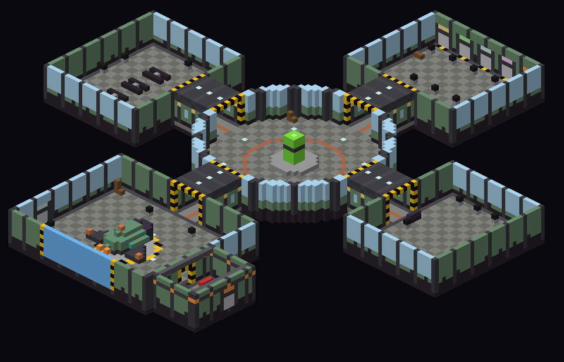

# Station hub

The station is the main hub and stays compact: a domed central concourse, four short corridors and four wings.
Everything else (mines, fishing, workshop bays, the Undercroft, planetside places) is somewhere else and reached
by **terminals** and **warps**. The hub is drawn in code (`station/HubLayout.java`) so it is reproducible and
versioned; bump `HubLayout.VERSION` when you change it and servers rebuild it on the next start.



Renders made from the layout code (not in-game screenshots; the resource pack makes it grungier in game).
More: [exterior](img/station-hub-exterior.png), [floor plan](img/station-hub-plan.png).

## Layout (world `station`, players stand at y=64, spawn 0.5 64 9.5 facing north)

| Area | Where | Terminals (key → default action in `station.yml`) |
| --- | --- | --- |
| Concourse | domed ring r≈20 around the reactor core at 0,0 | signs to each wing |
| Mine Lifts (north) | x -14..14, z -54..-31 | `lift-scrapyard..lift-foundry` → `/mine <first mine of deck>`, `lift-best` → `/mine`, `mine-directory` → `/mines`, `parkour` → `/parkour` |
| Exchange (east) | x 31..54, z -14..14 | `sell`, `cargo`, `drill`, `rankup`, `grades`, `auction` → `/ah`, `auction-claims` → `/ah claims`, `salvage` → `/salvage` |
| Crew Deck (west) | x -54..-31, z -14..14 | `quests`, `contracts`, `gang`; bar and lounge, room for quest NPCs |
| Shuttle Bay (south) | x -18..18, z 31..60 | `shuttle-board` → board of `planetside` + `danger` warps, `fishing` → warp `fishing`, `workshop` → warp `workshop` (falls back to `/workshop`) |
| Guard Checkpoint | x 20..30, z 44..58 (off the bay) | `undercroft` → warp `undercroft` |

Terminals are a lodestone console with a button; right-click either. Text displays label everything and are
tagged `spacepunk_station` so rebuilds replace them.

## Warps (`api.WarpService`)

Other modules register their own destinations; nothing about them is hard-coded in the hub:

```java
Services.find(WarpService.class).ifPresent(w -> w.register(new WarpService.Warp(
        "fishing-tidepools", "<aqua>Tidepool Flats", WarpService.PLANETSIDE, Material.FISHING_ROD,
        List.of("<gray>Planetside shallows."), player -> spot.clone(), player -> null)));
```

- Categories: `planetside` and `danger` show on the Shuttle Board; `parkour`, `station` show on `/warps`;
  `private` (per-player, e.g. `workshop`) is only reached through its terminal or `/warp id`.
- `PlayerWarpEvent` fires before every trip; cancel it (with a reason) or change the destination.
- `hub()` / `sendToHub(player)` for return trips. Players join and respawn at the hub (respawn at LOW priority).
- Admins can add warps without code: stand somewhere and `/stationadmin setwarp ID [category] [name]`.

Commands: `/hub` (`/spawn`), `/warp ID`, `/warps`, `/stationadmin build|setspawn|setwarp|delwarp|warps|reload`.
