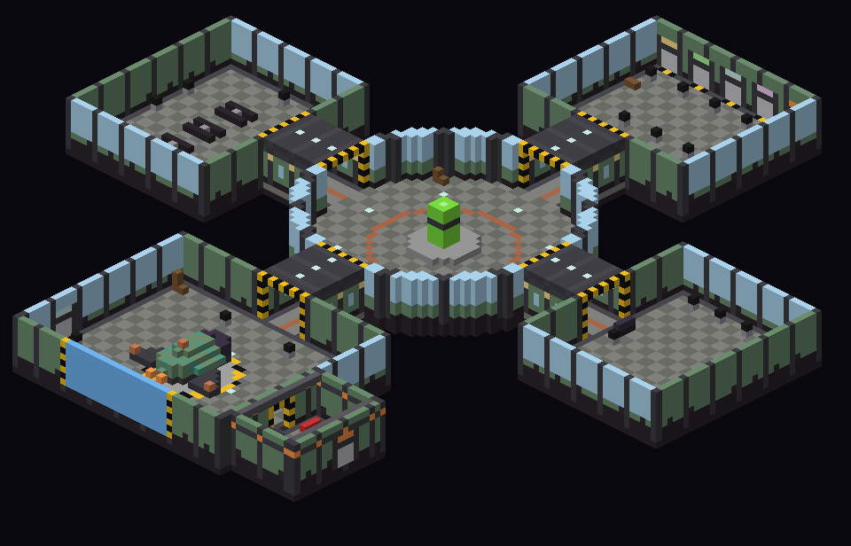

# Station hub and warps

The station is the hub of the server. You join and respawn on its concourse, and every other place (mines, fishing
pools, your workshop, the Undercroft) is reached from here by **terminals** and **shuttle warps**.

*Render made from the hub's layout code. In game the resource pack makes it grungier.*

## Layout

A domed **concourse** rings the reactor core in the middle. Four short corridors lead to four wings.

| Wing | Where | What's there |
| --- | --- | --- |
| **Mine Lifts** | North | A lift per deck (Scrapyard, Reactor Ducts, Cryo Vaults, Hull Breach, Core Foundry), a "best mine" lift, the mine directory and the parkour board |
| **Exchange** | East | Sell, Cargo, Drill, Rank Up, Grades, Black Market, Auction Claims and Salvage terminals |
| **Crew Deck** | West | Quests, Contracts and Gang terminals, a bar and lounge, and the story characters |
| **Shuttle Bay** | South | The Shuttle Board, the Fishing airlock and the Workshop airlock |
| **Guard Checkpoint** | Off the Shuttle Bay | The Undercroft gate |

**Terminals** are lodestone consoles with a button. Right-click either to use it. Every terminal just runs the
matching command, so you can always type the command instead.

## Commands

| Command | What it does |
| --- | --- |
| `/hub` (`/spawn`, `/station`) | Back to the concourse |
| `/warps` (`/shuttle`) | Open the Shuttle Board |
| `/warp <id>` | Travel to a warp by id |

## Warps

Every zone registers its own destinations, and they show up on the boards automatically.

| Warp | Where it goes |
| --- | --- |
| `fishing` | The Bilge Hub in the station waters |
| `fishing-<pool>` | A fishing pool, e.g. `fishing-cryo` |
| `workshop` | Your own hull bay (built on the spot the first time) |
| `undercroft` | The Undercroft's Guard Checkpoint |
| `parkour-<mine>` | A mine's maintenance run, e.g. `parkour-scrapyard-1` |

The Shuttle Board lists **planetside** and **danger** destinations; `/warps` also lists parkour and station warps.
Private warps like your workshop are only reached through their terminal or `/warp`.

## How it ties into progression

The hub is where you sell, rank up, upgrade the drill, take quests, and reach every other system. The story
characters (Foreman Rusk, Tech Vell, Archivist Nhem, Kade and the Warden) stand on the Crew Deck; right-click one to
open your quest log.
